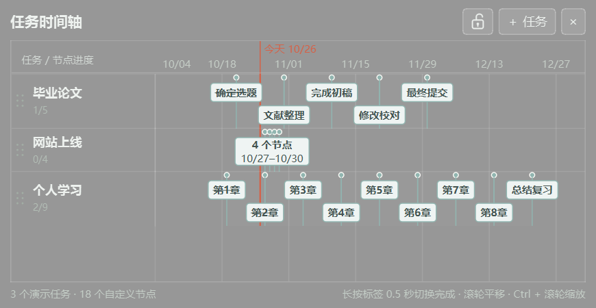

# TaskCalendar

一个轻量的 Windows Qt 桌面待办时间轴。每行一个任务，节点名称、数量和日期均可自由设置。



*实际 Qt 界面；任务与日期均为演示数据。*

## 功能

- 为任务添加任意数量的命名节点，日期可留空；支持直接输入、粘贴或日历选择。
- 日期接受 `YYYY-MM-DD`、`YYYY/M/D`、`YYYYMMDD`，显示本地日期及倒计时。
- 空间充足时显示名称、日期与倒计时；拥挤标签只显示名称并错成两行，极密集节点合并，点击展开全部内容。
- **长按单个标签 0.5 秒**，圆环读满后切换完成状态；移出取消，继续按住不会重复触发，再次长按可撤销完成。
- 短按标签展开详情，聚合标签通过详情逐个勾选完成；完成后名称加删除线。
- 统一浅色标签，无颜色分类与图例。半透明灰色背景、锁定和默认桌面伴随。

## 下载与运行

从 [最新 Release](https://github.com/Sur-Ring/TaskCalendar/releases/latest) 下载 `TaskCalendar-v1.0.0-windows-x64.zip`，**解压整个文件夹**，双击 `TaskCalendar.exe`。包内附带 Qt 和 MinGW 运行依赖，无需安装 Qt；请保留 DLL 和插件目录。

发布环境为 Windows 11 x64、Qt 6.8.3。其他 Windows 版本尚未验证。首次启动为空列表，截图仅为演示数据。

## 操作

| 操作 | 效果 |
| --- | --- |
| 左侧名称区滚轮 | 上下滚动列表 |
| 右侧时间轴滚轮 | 平移时间范围 |
| 时间轴 Ctrl＋滚轮 | 缩放时间范围 |
| 单击名称 | 编辑或删除记录 |
| 拖动左侧六点柄 | 调整行顺序 |
| 选中行后 Alt＋↑ / ↓ | 调整行顺序 |
| 点击越界的“← 今天”或“今天 →” | 回到今天附近 |
| 点击锁图标 | 锁定／解锁窗口位置及大小 |

日期表头和今天标注固定在顶部；每次启动默认显示今天。解锁后可拖动标题区域移动窗口、拖动边缘调整大小，× 退出应用。

## 数据与自启动

默认数据目录为 `%APPDATA%/TaskCalendar/TaskCalendar/`，保存 `tasks.json` 和 `settings.ini`。更新程序前备份该目录；替换程序文件不会清空这里的数据。也可指定便携数据目录：

```powershell
.\TaskCalendar.exe --data-dir .\my-data
```

登录 Windows 时自动启动：按 Win＋R，输入 `shell:startup`，将 `TaskCalendar.exe` 的**快捷方式**放入打开的文件夹。快捷方式应指向固定存放的完整程序目录；移除该快捷方式即可取消自启动。

## 从源码构建

需要 CMake 3.16+、C++17、Ninja 和 Qt Widgets。编译器必须与 Qt ABI 匹配，并将 Qt 与编译器的 bin 加入 PATH。测试还需要 Qt Test。

```powershell
cmake -S . -B build -G Ninja -DCMAKE_PREFIX_PATH="你的 Qt 安装目录"
cmake --build build --target TaskCalendar TaskCalendarTests
ctest --test-dir build --output-on-failure
```

本版本已通过 Windows 原生平台及 offscreen 自动测试。测试使用临时数据，不访问真实记录。可通过 `-DBUILD_TESTING=OFF` 关闭测试目标。

## 许可

项目沿用仓库中的 [GNU AGPL v3](LICENSE)。发行包使用动态链接的 Qt，第三方许可与来源见 `THIRD_PARTY_NOTICES.md` 和包内 `licenses/`。源码可从本仓库对应 Release 标签获取。

## 与 PaperCalendar 的关系

基于 [PaperCalendar](https://github.com/Sur-Ring/PaperCalendar) 的桌面框架开发。两个程序的数据、设置和自启动入口独立，可同时使用。复制保留的旧会议模型、旧测试及 HTML 原型仅为历史参考，当前构建使用任务模型与任务测试，不启用 WorkerW。
